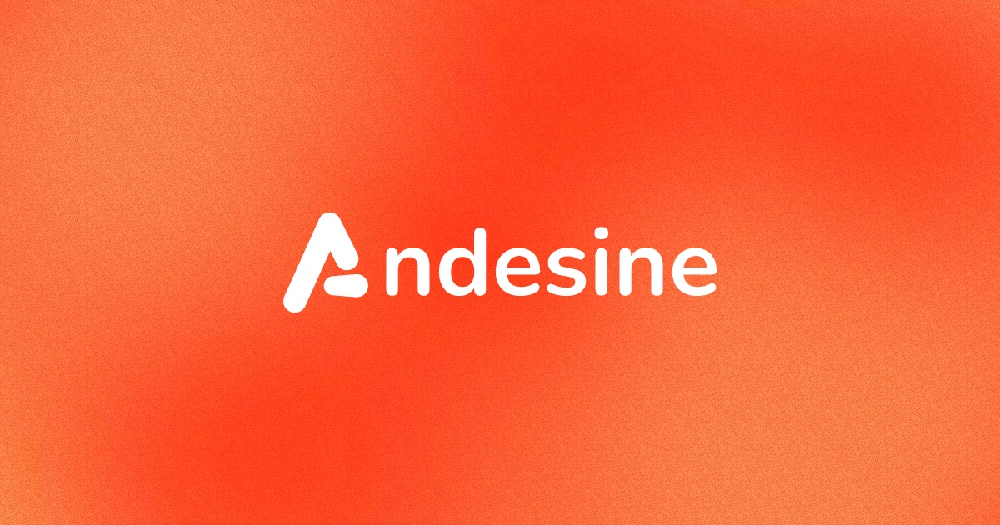

# Andesine

**The versatile content workspace.** Write with your team, give your content a structure, and
publish it to websites, apps, and AI agents.

[Website](https://andesine.app) · [Docs](https://andesine.app/docs) ·
[Changelog](https://github.com/vriteio/andesine/releases) ·
[Discussions](https://github.com/vriteio/andesine/discussions) · [X](https://x.com/andesineapp) ·
[LinkedIn](https://www.linkedin.com/company/andesineapp)

## Features

- **Real-time editor** with Markdown shortcuts, tables, code blocks, images, and components.
- **Structured content**: collections, schemas with properties and fragments, and versions.
- **Publishing** to channels, with hosted documentation sites, an API and SDK, and two-way GitHub
  sync.
- **AI**: search and answers with sources, and an MCP server for Claude, ChatGPT, Cursor, and
  other AI apps.
- **Teams**: roles, groups, restricted collections, and extensions.

## Get started

- **Andesine Cloud**: sign up at [andesine.app](https://andesine.app).
- **Self-hosting**: run Andesine with Docker Compose. See
  [Self-hosting](https://andesine.app/docs/self-hosting/).

## Packages

| Package                                              | Description                         | Docs                                                                       |
| ---------------------------------------------------- | ----------------------------------- | -------------------------------------------------------------------------- |
| [`andesine`](packages/public/cli)                    | Command-line tools and MCP server   | [CLI](https://andesine.app/docs/developers/cli/)                           |
| [`@andesine/sdk`](packages/public/sdk)               | TypeScript API client               | [SDK](https://andesine.app/docs/developers/sdk/)                           |
| [`@andesine/converters`](packages/public/converters) | Content format converters           | [Converters](https://andesine.app/docs/developers/converters/)             |
| [`@andesine/extensions`](packages/public/extensions) | Authoring tools for extensions      | [Build extensions](https://andesine.app/docs/extensions/build-extensions/) |
| [`@andesine/pages`](packages/public/pages)           | Documentation site framework        | [Pages framework](https://andesine.app/docs/publishing/pages-framework/)   |
| [`@andesine/ui`](packages/public/ui)                 | Headless components for Pages sites | [Pages framework](https://andesine.app/docs/publishing/pages-framework/)   |

## Support

- Questions and ideas: [GitHub Discussions](https://github.com/vriteio/andesine/discussions).
- Bugs: [GitHub Issues](https://github.com/vriteio/andesine/issues).
- Security issues and other requests: [support@andesine.app](mailto:support@andesine.app). Do
  not report security issues in public.

## License

The code is under the [AGPL-3.0](LICENSE) unless a file or folder says otherwise. The public
packages and templates are under the MIT license, and the billing code is under the Elastic
License 2.0. Copyright © Vrite, Inc.
